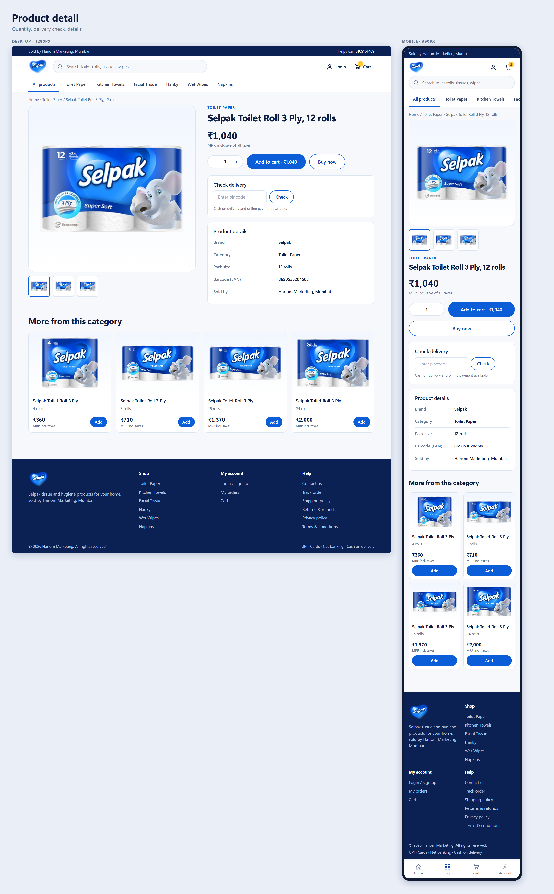

# Selpak Store

A B2C e-commerce storefront for Selpak tissue and hygiene products: toilet paper, kitchen towels,
facial tissue, hankies, wet wipes and napkins. Customers can browse the catalogue, add items to a
cart, and check out with online payment (Razorpay) or cash on delivery.

This repository contains the **frontend**, the **UI design** it was built from, and the **team
documentation**. The backend (database, API, payment verification) is built by a separate team.

<p align="center">
  
</p>

## Design and screenshots

Every screen was designed before development, in desktop and mobile sizes.

- **[Full design (PDF)](design/Selpak_Store_Design.pdf)** — all screens in one file
- **[Team guide (PDF)](docs/Selpak_Team_Guide.pdf)** — project structure, team roles, workflow and launch plan
- **[API contract](docs/API_CONTRACT.md)** — the endpoints the frontend expects from the backend

| Screen | Image |
|---|---|
| Sitemap and user flows | [01-sitemap-userflow.png](design/screenshots/01-sitemap-userflow.png) |
| Design system | [02-design-system.png](design/screenshots/02-design-system.png) |
| Home | [03-home.png](design/screenshots/03-home.png) |
| Shop / category | [04-shop.png](design/screenshots/04-shop.png) |
| Product detail | [05-product.png](design/screenshots/05-product.png) |
| Cart | [06-cart.png](design/screenshots/06-cart.png) |
| Checkout | [07-checkout.png](design/screenshots/07-checkout.png) |
| Order placed | [08-order-placed.png](design/screenshots/08-order-placed.png) |
| My orders | [09-my-orders.png](design/screenshots/09-my-orders.png) |
| Login / sign up | [10-login.png](design/screenshots/10-login.png) |
| Contact | [11-contact.png](design/screenshots/11-contact.png) |

The original HTML mockups are in [`design/`](design/); open `design/index.html` in a browser.

## Features

- **Catalogue** — home page, 6 category pages and 40 product pages, with search, filters and sorting
- **Cart** — quantities, totals, and a cart that survives closing the browser
- **Checkout** — validated address form, cash on delivery, and online payment with failure and retry handling
- **Orders** — order confirmation, order details, progress tracking and one-click reorder
- **Account** — mobile number + OTP login, order history and profile
- **Support** — contact form and shipping, returns, privacy and terms pages
- **SEO** — page titles and descriptions, canonical URLs, product structured data, sitemap and robots.txt
- **Responsive** — mobile-first layout with a bottom navigation bar and accessible, keyboard-friendly forms

## Tech stack

| Tool | Used for |
|---|---|
| [Next.js 16](https://nextjs.org) (App Router) | Framework, routing, static pages, image optimisation |
| React 19 | UI components |
| TypeScript | Type safety |
| Plain CSS with design tokens | Styling (`web/src/app/globals.css`) |
| ESLint | Code quality |

## Getting started

You need [Node.js](https://nodejs.org) 20.9 or newer.

```bash
git clone https://github.com/roshantiwati0/selpak-store.git
cd selpak-store/web
npm install
npm run dev
```

Open http://localhost:3000.

| Command | What it does |
|---|---|
| `npm run dev` | Start the development server |
| `npm run lint` | Check the code with ESLint |
| `npm run build` | Create a production build |
| `npm run start` | Serve the production build |

## Demo mode

Without a backend, the app runs in **demo mode** so the whole flow can be used and tested:

- Login OTP is always `123456` (no SMS is sent)
- Orders and login are saved in your browser's local storage
- "Pay online" opens a test payment screen; no real money is taken

To connect a real backend, copy `web/.env.example` to `web/.env.local` and set
`NEXT_PUBLIC_API_URL`. See the [API contract](docs/API_CONTRACT.md) for the endpoints.

## Project structure

```
selpak-store/
├─ web/                 Frontend application
│  ├─ public/products/  Product images
│  └─ src/
│     ├─ app/           Pages (one folder per URL)
│     ├─ components/    Reusable UI components
│     ├─ data/          Product catalogue
│     ├─ lib/           Catalogue queries, API layer, config, formatting
│     └─ store/         Cart, login, saved address and toast state
├─ design/              HTML mockups, design system, screenshots and design PDF
└─ docs/                Team guide (PDF) and API contract
```

More detail is in [`web/README.md`](web/README.md) and the [team guide](docs/Selpak_Team_Guide.pdf).

## Project status

The frontend is complete and tested in demo mode. Before launch, the following still needs to be done:

- Connect and test the real backend API (the HTTP client is written but not yet tested against a server)
- Connect and test live Razorpay payments and SMS OTP
- Confirm prices, delivery charges and delivery areas with the seller
- Replace the draft policy pages with the seller's final text
- Add automated tests

Prices shown are the catalogue MRP. Order numbers and addresses in the design screenshots are sample data.

## Sold by

Hariom Marketing, Mumbai.
